  <picture>
    <source media="(prefers-color-scheme: dark)" srcset="assets/hero-dark.svg">
    
  </picture>

## 🐟 你好，我是惊鱼

- ~~西电本科无敌鶸~~ 人工智能背景，Python 持续学习中
- 🐮🐴 引望牛马一枚；工位之外，认真 vibe coding
- 2022.12.05 第一次打开 ChatGPT，从此没再上岸
- 信第一性原理：能少一层就少一层；好看也算功能

  <picture>
    <source media="(prefers-color-scheme: dark)" srcset="assets/divider-dark.svg">
    
  </picture>

## 🫧 鱼缸里养着的小东西

<a href="https://github.com/amazing-fish/FishTouchingCoin">
  <picture>
    <source media="(prefers-color-scheme: dark)" srcset="assets/project-coin-dark.svg">
    
  </picture>
</a>

按时薪给摸鱼计价。平时只是桌角一个暗灰色小数字，旁人看不出它是什么。  
习性：`F9` 秒藏，藏起来照常计费。

<table>
  <tr>
    <td width="50%" valign="top">
      <a href="https://github.com/amazing-fish/install_new_apk_hap">
        <picture>
          <source media="(prefers-color-scheme: dark)" srcset="assets/project-apk-dark.svg">
          
        </picture>
      </a>
      

        扫一眼目录，把最新 APK / HAP 并行装进连着的手机，拖放即扫、顺手拉日志。 
        习性：v1.0 重构为现代桌面界面，多台设备并发安装也能一键喊停。
      

    </td>
    <td width="50%" valign="top">
      <a href="https://github.com/amazing-fish/TODOList">
        <picture>
          <source media="(prefers-color-scheme: dark)" srcset="assets/project-todo-dark.svg">
          
        </picture>
      </a>
      

        蹲在托盘里的轻量待办：快录搜索、周期任务、到点提醒与一键推迟，跟随系统换深浅色。 
        习性：误删误勾 5 秒内 <code>Ctrl+Z</code> 撤销；点「知道了」只是不催了，绝不偷偷清截止。
      

    </td>
  </tr>
  <tr>
    <td width="50%" valign="top">
      <a href="https://amazing-fish.github.io/CodeX-YI/">
        <picture>
          <source media="(prefers-color-scheme: dark)" srcset="assets/project-yi-dark.svg">
          
        </picture>
      </a>
      

        <a href="https://github.com/amazing-fish/CodeX-YI">CodeX-YI</a>：三钱起卦、六十四卦方图，附王弼本经传原文，自动标出该读哪一爻。 
        习性：卦象数据不对宁可不显示；<a href="https://amazing-fish.github.io/CodeX-YI/">点开就能用</a>，fork 自 <a href="https://github.com/jiao-ling/CodeX-YI">jiao-ling/CodeX-YI</a>。
      

    </td>
    <td width="50%" valign="top">
      <a href="https://github.com/amazing-fish/dsh-piano-nav">
        <picture>
          <source media="(prefers-color-scheme: dark)" srcset="assets/project-dsh-dark.svg">
          
        </picture>
      </a>
      

        给 <a href="https://github.com/deepseek-ai/deepseek-harness">DeepSeek Harness</a> 长对话加上语义琴键导航轨道：完整历史、结构化问答、过程折叠与连续鼠标波形。 
        习性：已独立维护并发布 npm 包 <code>dsh-piano-nav</code>；轨道自适应已<a href="https://github.com/hjj345/dsh-sm-context-piano/pull/3">合入上游</a>，另维护 <a href="https://github.com/amazing-fish/dsh-plugins">dsh-plugins</a> 补丁台账。
      

    </td>
  </tr>
  <tr>
    <td width="50%" valign="top">
      <a href="https://github.com/amazing-fish/mu-5x-fibonacci-trading">
        <picture>
          <source media="(prefers-color-scheme: dark)" srcset="assets/project-mu-dark.svg">
          
        </picture>
      </a>
      

        把盯 MU 的多头想法变成可重复回测、可解释信号、邮件提醒和本机交互式复盘台账。 
        习性：行情缺了、坏了、过期了，宁可不出信号；下单由人来，非自动交易，也不构成投资建议。
      

    </td>
    <td width="50%" valign="top">
      <a href="https://github.com/amazing-fish/agent-skills">
        <picture>
          <source media="(prefers-color-scheme: dark)" srcset="assets/project-skills-dark.svg">
          
        </picture>
      </a>
      

        个人 Agent Skill 资产库：涵盖目标澄清（<code>optimize-prompt</code>）、受控 Issue-to-PR 闭环与离线 3-Tab 交互式汇报（<code>report-for-human</code>）。 
        习性：每个 Skill 独立可验证，外部来源锁死在 <code>sources.lock.json</code>，汇报不越权代批。
      

    </td>
  </tr>
</table>

<a href="https://github.com/amazing-fish/ghost_VPD">
  <picture>
    <source media="(prefers-color-scheme: dark)" srcset="assets/project-vpd-dark.svg">
    
  </picture>
</a>

面向鸿蒙智行 / 乾崑的手机 APP 智能自动化测试：Agent 驱动确定性执行器 `vpdtest`，产出可重复执行、可独立判定、证据可追溯的功能测试用例。  
习性：带授权闸门、复核与运动看门狗，日常回归走全量离线本地 CI，不靠玄学过测。

## 🐱 猫窝值班表

猫窝是从 [上游 Clowder AI](https://github.com/zts212653/clowder-ai) fork 来的（[我的 fork](https://github.com/amazing-fish/clowder-ai)）。猫不是我生的，我负责喂粮和验收。

| 谁 | 负责 |
| --- | --- |
| 布偶猫 | 定方向 |
| 缅因猫 | 动手写 |
| 两只猫 | 互相挑刺 review |
| 🐟 | 拍板和验收 |

  <picture>
    <source media="(prefers-color-scheme: dark)" srcset="assets/divider-dark.svg">
    
  </picture>

## 🍤 鱼食配方

  <picture><source media="(prefers-color-scheme: dark)" srcset="assets/badge-python-dark.svg"></picture>
  <picture><source media="(prefers-color-scheme: dark)" srcset="assets/badge-typescript-dark.svg"></picture>
  <picture><source media="(prefers-color-scheme: dark)" srcset="assets/badge-javascript-dark.svg"></picture>
  <picture><source media="(prefers-color-scheme: dark)" srcset="assets/badge-agent-dark.svg"></picture>
  <picture><source media="(prefers-color-scheme: dark)" srcset="assets/badge-uiux-dark.svg"></picture>

## 🌡️ 水质检测报告

  <picture>
    <source media="(prefers-color-scheme: dark)" srcset="https://github-readme-stats-jiaolings-projects.vercel.app/api?username=amazing-fish&show_icons=true&bg_color=16303F&title_color=F2C96B&text_color=EAF2F5&icon_color=6CC3CF&border_color=2D5163&border_radius=14&cache_seconds=21600&v=20261126">
    
  </picture>
  &nbsp;
  <picture>
    <source media="(prefers-color-scheme: dark)" srcset="https://github-readme-stats-jiaolings-projects.vercel.app/api/top-langs/?username=amazing-fish&layout=compact&bg_color=16303F&title_color=F2C96B&text_color=EAF2F5&icon_color=6CC3CF&border_color=2D5163&border_radius=14&cache_seconds=21600&v=20261126">
    
  </picture>

  <picture>
    <source media="(prefers-color-scheme: dark)" srcset="assets/footer-dark.svg">
    
  </picture>

  游过路过，欢迎来鱼缸边聊 Agent、小工具和任何好玩的点子 
  📮 <a href="mailto:huangziao99@126.com">huangziao99@126.com</a> 
  今日也在认真摸鱼 🐟

